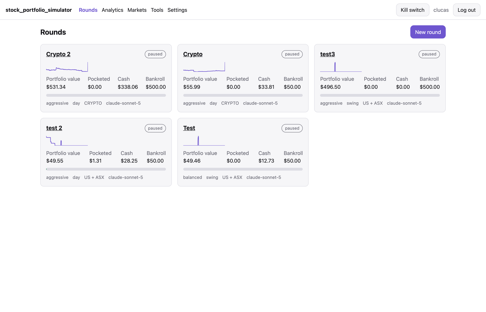
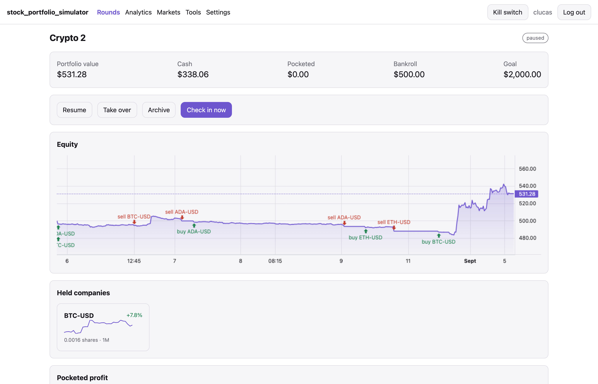
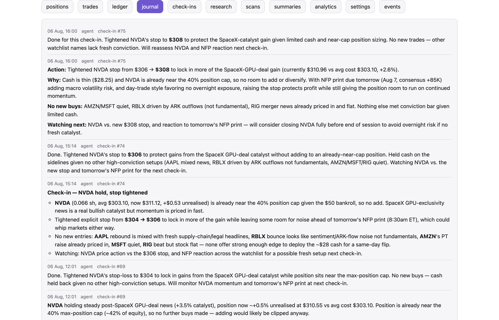
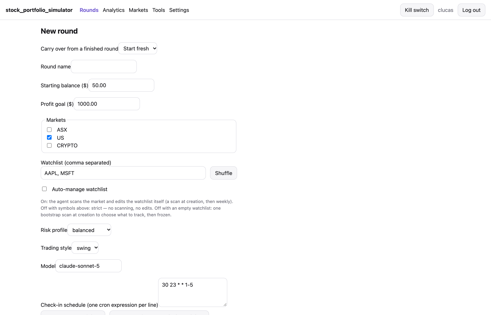
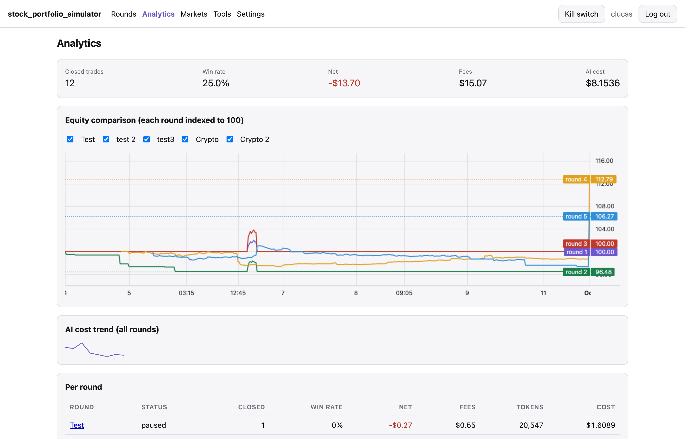
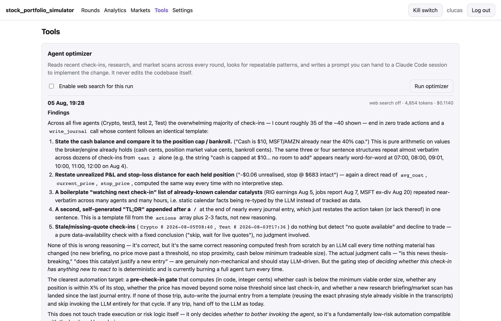

# Stock Portfolio Simulator

What would happen if you gave an AI fifty bucks and let it play the stock market?

That's what this app is for. You set up a "round" with a small pretend bankroll, point it at
the Australian market, the US market, crypto, or a mix, and let Claude trade on its own. It
checks in on a schedule, reads the news, looks at prices, decides what to buy and sell, and
writes down why. No real money is involved. Every trade is simulated against live market
prices.



## The idea: bank the wins

Most trading simulators just track a balance going up and down. This one has a twist. Every
time a sale pushes your cash above what you started with, the extra gets **pocketed**. It's
taken off the table and can never be lost on a later trade.

Say you start with $50:

1. The AI buys $20 worth of something.
2. It sells it later for $40. Cash is now $70.
3. The $20 profit is pocketed, and cash goes back to $50.

The AI always plays with the same starting bankroll, and the profit pile only ever grows. Each
round has a profit goal. Once the pocketed total hits it, the round pauses and you can start a
fresh one.

## Watching a round

Each round gets its own page. You can see what it's worth right now, how much it has pocketed,
what it's holding, and a chart of every buy and sell along the way.



The best part is the **journal**. After every check-in, the AI writes up what it did and why:
which stocks it looked at, why it passed on some, where it moved its safety nets, and what it's
watching next time.



## You stay in charge

The AI never gets free rein:

- **Safety nets.** Each round has a stop-loss (sell automatically if a stock drops too far), a
  cap on how much can go into any single stock, and an automatic pause if the whole round falls
  too far.
- **Take over.** Hand the round to yourself at any time and trade manually. The AI drops back to
  just taking notes.
- **Kill switch.** One button at the top of every page pauses everything at once. The safety
  nets keep working while it's paused.

Setting up a round takes one form: a name, a bankroll, a goal, which markets to trade, how
cautious or aggressive to be, and how often to check in.



## Learning from it

The analytics page puts every round side by side: how many trades won, how much went on fees,
how much the AI itself cost to run, and how each round's value moved over time.



There's also an **optimizer** on the Tools page. It reads back through all the AI's past
check-ins, spots habits (like writing the same "nothing to do" note over and over), and
suggests improvements.



A few other things it does:

- **Research briefings.** On a schedule, the AI searches the web for news about what it's
  watching, so its next check-in has some context.
- **Auto-picked watchlists.** If you don't want to choose the stocks yourself, it can scan the
  market and pick some, but only real, currently-trading symbols.
- **What-if replays.** Rerun a round's trades with different safety-net settings to see whether a
  tighter stop-loss would have helped.
- **Phone notifications** via [ntfy](https://ntfy.sh) when something interesting happens.

## What you'll need

- **A Claude subscription** (Pro or Max). That's what pays for the AI. You don't need an
  Anthropic API key or a separate pay-per-use account.
- **Docker**, to run everything.
- **The Claude Code CLI** (`claude`). It's only used once during setup, to sign in to your
  subscription.
- **Node 22**, only if you want to run it outside Docker.

Stock and crypto prices come from Yahoo Finance, which is free and needs no account. Phone
notifications through [ntfy](https://ntfy.sh) are optional.

### How Claude is connected (no API key)

The app talks to Claude through [OneCLI](https://onecli.sh), a small local gateway that runs
in Docker alongside the app. During setup you sign in to your Claude subscription once, and
OneCLI keeps that sign-in to itself. When the app calls Claude, OneCLI adds your credentials
to the request on the way out.

So the app itself never holds a password, token or API key. There's nothing to paste into a
config file and nothing to accidentally commit to git.

### What it's built with

| Part | Built with |
| --- | --- |
| Dashboard | React, Vite, TanStack Query, lightweight-charts |
| Server | Node.js, TypeScript, Express |
| Database | SQLite (one file on disk) |
| AI | Claude, via the Claude Agent SDK, routed through OneCLI |
| Market data | Yahoo Finance |
| Packaging | Docker Compose, with nginx serving the dashboard |

## Running it

From the project folder:

```bash
./scripts/setup.sh
```

That connects your Claude account, starts everything up, and asks you to pick a username and
password. Then open http://localhost:8088.

If you'd rather run it without Docker, start the two halves in separate terminals:

```bash
cd backend  && npm install && npm run dev
cd frontend && npm install && npm run dev
```

Create a login with `cd backend && npm run cli -- create-user <name>`, then open
http://localhost:5173. The AI features still need OneCLI running, so start just that part with
`docker compose up -d onecli onecli-postgres`.

## Good to know

- **It's a simulator.** Prices are real, but trades are pretend. Real-money trading may come
  later, but only after proper tax reporting is in place.
- **Fees are simulated too**, so a round pays roughly what a real broker would charge.
- **The AI isn't free.** Each check-in uses part of your Claude subscription, and the app tracks
  how much.

## Ideas for the future

- Choose how many stocks a market scan should watch
- Have market scans explain why they picked or dropped each stock
- Show a live "the AI is working" indicator on a round
- Make market scans pay attention to how cautious or aggressive the round is
- Run research every day by default, not just weekdays
- Reset a single round, or wipe the whole app clean
- Show charts for every stock on the watchlist, not just the ones being held
- Let a round reinvest its profits instead of pocketing them
- Skip check-ins when all of a round's markets are closed
- Switch between AI models, including other cloud providers and models running on your own
  computer
- Tax reporting
- Real-money trading through an actual broker

## For developers

The design spec and implementation plans are in `docs/superpowers/`, and `CLAUDE.md` has the
detailed technical notes.
